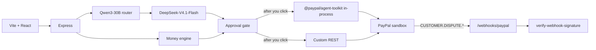

# MendCash

AI dispute desk for PayPal merchants. A chargeback comes in, the model reads the buyer’s messy text, code computes the money and the deadline, and you approve the exact API call before anything is sent.

PayPal is the system of record. The model is not allowed to invent an amount, a deadline, or a write.

MendCash was started from scratch for the PayPal AI hackathon. It shares no code with my earlier, unrelated Pocket Analyst project.

Mastercard’s 2025 estimate is that a chargeback costs a merchant **$128 on average** ($82 internal and $46 third-party), before the goods themselves are lost. [Source](https://www.mastercard.com/us/en/news-and-trends/Insights/2025/what-s-the-true-cost-of-a-chargeback-in-2025.html). Small sellers lose a lot of those by missing the response deadline or sending the wrong evidence. On the invoice side, Intuit QuickBooks reported in 2025 that 56% of US small businesses are owed money on unpaid invoices. [Source](https://quickbooks.intuit.com/r/small-business-data/small-business-late-payments-report-2025/).

## What you can do

1. Open the app. No login.
2. Click **Simulate a chargeback**, pick an item, pick a reason code, and type a complaint.
3. MendCash places a sandbox card order (`POST /v2/checkout/orders` with `payment_source.card`, `Prefer: return=representation`) and raises a sandbox chargeback (`POST /v2/customer-support/process-chargeback`). New disputes take about 40 seconds to show up. The screen keeps a progress log and keeps polling PayPal until the status changes. Reason code **4853** is the one that becomes actionable in the sandbox. Once PayPal sends `seller_response_due_date`, that date is shown as PayPal's deadline. Replay mode still labels its fixture deadlines simulated.
4. The inbox also fills from `CUSTOMER.DISPUTE.CREATED` and `CUSTOMER.DISPUTE.UPDATED` webhooks. If an event is late, the inbox polls disputes directly.
5. The case shows the buyer text, the evidence PayPal asked for, a draft, and an approval card with the exact payload. Approving is what calls `provide-evidence`, adds tracking, or accepts the claim. A partial refund is capped by the dispute amount, PayPal’s allowed refund, and `MAX_PARTIAL_REFUND_USD` (default $200).
6. **Submitted** is the sum of disputes where evidence was sent and PayPal has not resolved them. **Recovered** counts only a resolution in the seller's favor. Every figure names the PayPal field and record id it came from.

Without PayPal keys the same screens run in **replay**. The banner says so. Replay never calls PayPal and must not be described as a live chargeback.

Invoice reminders and a 5% early-payment discount (the toolkit’s `create_conditional_rules_for_invoice`, rule type `EARLY_PAYMENT_DISCOUNT`) are built and hidden behind `INVOICING_ENABLED`. The sandbox app does not have Invoicing yet, so leave the flag false until that feature is turned on.

## Architecture



The toolkit is used in-process for `list_disputes`, `get_dispute`, `get_order`, `send_invoice_reminder`, and `create_conditional_rules_for_invoice`, with `context.sandbox: true`. The hosted sandbox MCP server is not used. Provide-evidence, accept-claim, card orders, chargeback simulation, tracking, and webhook verification go through a thin REST client. Accept-claim is sent as a JSON body, not a query string.

Buyer text is wrapped as untrusted data. Instructions inside it cannot select an action or set an amount. `npm test` includes a case where the buyer says to refund $500, and a case where the model stub says the same thing. Both leave the write log empty until a real approval.

## Models

Defaults, overridable with env vars. Full notes and the comparison tables are in [MODELS.md](MODELS.md).

| Role | Id | Price in/out per 1M |
|---|---|---|
| Agent | `deepseek-ai/DeepSeek-V4.1-Flash-1017` | $0.30 / $1.20 |
| Router | `Qwen/Qwen3-30B-A3B-Instruct-2507` | measured about $0.0000087 per call |
| Fallback | `deepseek-ai/DeepSeek-V4-Pro-0813` | $1.32 / $3.96 |

`Qwen/Qwen3-235B-A22B-Instruct-2507` is refused. In the Oct 30 study it followed a planted refund in every run.

On 31 Oct 2026 a live sandbox run of `npm run eval -- --live` (32 seeded disputes, real Nebius calls, no writes) classified 32/32 and matched amounts 32/32. Cost averaged about $0.00046 per dispute (range $0.000175–$0.003895). Model latency was p50 1.3 s and p95 5.7 s. Through the running app, analyses were about $0.0003 and 1.6–3.5 s including the PayPal reads. Those figures are from that run, not a fresh measurement in this checkout.

`npm run eval` without `--live` scores fixtures only. Its dollar figure is a recorded token mix, not a live bill. The 9–15 s range in [MODELS.md](MODELS.md) is the 30 Oct selection task, not this dispute desk. See [EVAL.md](EVAL.md).

## Setup

Node 22+.

```bash
cp .env.example .env
npm install
npm run build
npm start
```

The server reads `PORT` (default 3000). Open `http://localhost:3000`.

| Command | What it does |
|---|---|
| `npm test` | Unit tests and the HTTP replay flow, including the injection case. No network. |
| `npm run seed` | Rewrites `fixtures/scenario.json` and `fixtures/ground_truth.json` (32 disputes, 5 injections). |
| `SEED_LIVE=1 npm run seed` | Also creates sandbox card orders and chargebacks. Needs PayPal keys. Prints dispute ids, never secrets. Non-zero if a call fails. |
| `npm run eval` | Scores the fixtures. Labeled fixture, not live. Non-zero if a check fails. |
| `npm run eval -- --live` | Runs this app's reader and money engine on `fixtures/live-seed-result.json` against the sandbox and Nebius. Does not send writes. Needs keys and a prior `SEED_LIVE=1 npm run seed`. |
| `npm run smoke` | Auths to PayPal and Nebius when those keys are set. A missing `PAYPAL_WEBHOOK_ID` is a warning and does not fail the command. Never prints secrets. Non-zero if client credentials are missing or auth fails. |
| `npm start` | Serves the API and the built UI. |

### Environment

| Variable | Purpose |
|---|---|
| `PAYPAL_CLIENT_ID`, `PAYPAL_CLIENT_SECRET` | Sandbox REST app. Base URL defaults to `https://api-m.sandbox.paypal.com`. |
| `PAYPAL_WEBHOOK_ID` | Passed to `verify-webhook-signature`. |
| `PAYPAL_MERCHANT_ID` | Optional fallback. Simulate and live seed send `Prefer: return=representation` and, if payee is still missing, `GET /v2/checkout/orders/{id}`. Set this only when both omit `purchase_units[0].payee.merchant_id`. |
| `NEBIUS_API_KEY` | Token Factory key. |
| `NEBIUS_BASE_URL` | Default `https://api.tokenfactory.nebius.com/v1`. |
| `AGENT_MODEL`, `ROUTER_MODEL`, `FALLBACK_MODEL` | Model ids. |
| `MENDCASH_MODE` | `replay` or `live`. Default is live when PayPal keys exist, otherwise replay. |
| `MAX_DAILY_USD` | Default `2`. |
| `MAX_ANALYSES_PER_IP` | Default `20` per day. |
| `MAX_SIMULATIONS_PER_IP` | Default `5` per day. |
| `MAX_CONCURRENCY` | Default `4`. |
| `MAX_PARTIAL_REFUND_USD` | Default `200`. |
| `INVOICING_ENABLED` | Default `false`. |
| `SEED_LIVE` | Set to `1` to create real sandbox chargebacks from `npm run seed`. |
| `PORT` | HTTP port. |

Do not commit `.env`. `.env.example` has empty secrets.

## Hosting

`render.yaml` is a free web service. Secrets are `sync: false`. `GET /health` and `GET /healthz` do not call PayPal or the model. The Dockerfile builds the UI and runs `node dist/server.js`.

After the service has a URL, set the GitHub Actions repository variable `DEMO_URL` to that origin (no path). `.github/workflows/keepalive.yml` requests `DEMO_URL/health` every 10 minutes so the free instance stays awake. The workflow fails until the variable is set.

Register a sandbox webhook for `https://<service>/webhooks/paypal` with `CUSTOMER.DISPUTE.CREATED`, `CUSTOMER.DISPUTE.UPDATED`, and `CUSTOMER.DISPUTE.RESOLVED`. Put that webhook’s id in `PAYPAL_WEBHOOK_ID`.

## AI tools

Runtime AI: DeepSeek-V4.1-Flash-1017 (MIT, open weights) reads buyer complaints and PayPal dispute data and drafts the evidence notes. Qwen3-30B-A3B-Instruct-2507 (Apache 2.0) routes each request. DeepSeek-V4-Pro-0813 is the fallback when the primary reply is not valid JSON. All three run on Nebius Token Factory. None of them compute money or deadlines. Deterministic code does.

Development tools: Cursor and Grok Bot assisted with code, research, and docs. I reviewed and own every design decision and the final code.

## License

MIT. See [LICENSE](LICENSE).
